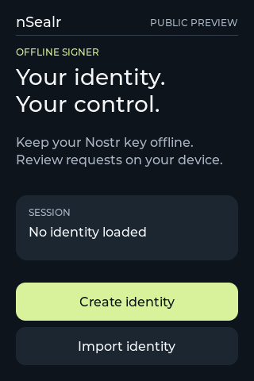
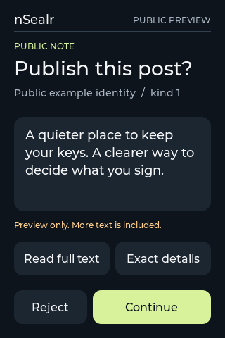

# nSealr

**Your Nostr identity, offline. Review and sign on your device.**

nSealr is being built as one open-source, camera-and-QR Nostr signer for the
Waveshare ESP32-P4 3.5-inch board. The connected companion prepares requests and
publishes results; identity secrets stay on the signer during normal operation.

**Development restart. No production release or real-key custody qualification
is available.** A desktop preview, host test or successful build does not prove
the device is ready to protect a real identity.

The product covers key creation/import, mnemonic and optional passphrase recovery,
deliberate backup, understandable event approval, and real threshold signing.
The device computes the event ID from the complete event. It does not ask users
to trust an ID or a summary supplied by their computer.

We are rebuilding the interface and simplifying the project around one device,
while retaining reviewed Rust core code, established cryptography and useful
independent tests. Historical experiments are preserved separately.

 

These are actual LVGL renders with public examples, not screenshots of qualified
firmware. [Build or explore the native preview](firmware/preview/README.md).

The portable core can be checked with Rust 1.95.0 and Python 3:

```sh
cargo test --workspace --locked --offline
```

Vendored dependency source, patches and license notices are preserved for offline
builds. [Core provenance and remaining coupling](docs/core-provenance.md) records
what was recovered and checked.

See [product](docs/product.md), [development status](docs/status.md) and
[source provenance](docs/provenance.md). Features listed as planned are not
implemented or qualified by being listed here.
