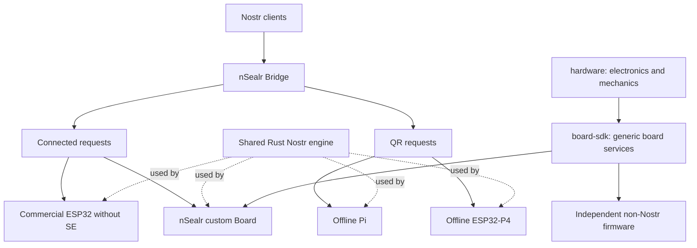

# Restart baseline — 2026-10-13

This is the engineering direction adopted for the restart. It does not mark future implementation or hardware tasks complete. Product software is pre-production.

The October 18 extension adds a proposed cross-device product contract, first-tranche development steps, hardware-reference findings and a clean-install KiCad runtime canary. Graph revision 5 strengthens entropy-provider and SE-reset acceptance. These additions clarify readiness; they do not close P01, E01 or any device release gate.

The objective is a useful Nostr signer ecosystem with accessible connected hardware, two independent offline implementations and a general-purpose programmable security board. Success means real client interoperability, understandable approval, reliable recovery and reproducible third-party development.

1. [Architecture and security boundaries](architecture.md)
2. [Repository and naming decisions](repositories.md)
3. [Execution and acceptance](execution.md)
4. [Measured source baseline](baseline.md)
5. [Machine-readable implementation graph](work-items.json)
6. [Decision validation and feasibility limits](validation.md)
7. [Client and optical qualification](client-qualification.md)
8. [Specification-first development and initial work packages](development.md)
9. [Proposed product contract, feature matrix and user journeys](product-contract.md)
10. [PCB pipeline, tool capabilities and reference designs](pcb-development.md)

The graph records **47 implementation tasks**, their dependencies, scope, acceptance and required resources. All remain open in this foundation: a research result or administrative rename is not a completed implementation gate. Ready tasks still require source reconciliation before work starts.

## Start here on the next session

Verify the actual checkout and run `python3 scripts/validate_restart_plan.py`. Begin R00 (repeatable baseline), P01 (per-profile requirements/threat models), S01/S02 (identity and secret boundaries), A01 (source disposition), E01 (required CAD operations) and O01 (coordination/evidence) in disjoint scopes. Collect component sources in parallel, but H01 acceptance depends on P01. The 2026-10-13 audit contains evidence to ingest into these tasks, not permission to mark them complete without reviewing their full acceptance criteria.

Then rehearse A02 locally: selected source only, explicit provenance, new clean contracts and green behavior checks. Archive a source repository only after its disposition is verified. Physical resources can block one profile without blocking the others.

## Delivery order

The first software milestone is a real request → device review → one-use authorization → valid response on an accessible board, with the expected key identity verified end to end. Offline Pi/P4 feasibility and board electronics research run alongside it. No date is promised before measured throughput and physical lead times exist.

The first public release is whichever retained profile satisfies its own safety and usability gates. General Board/SDK delivery has its own non-Nostr acceptance and does not wait for a complete wallet, SSH or FIDO application.

Old documentation, firmware profiles and fixtures remain source material during migration. Names and behavior inherited from them are not a compatibility commitment. Remove replaced active code when the replacement is verified; history remains in Git.

The diagram is the target architecture. It does not claim the depicted applications or PCB are already implemented. The SDK supports one trusted firmware image initially; future SSH/FIDO/wallet firmware needs separate application qualification.
