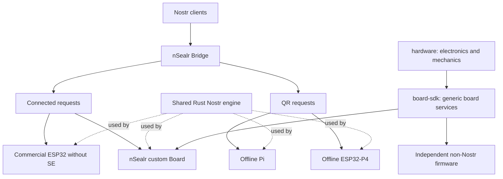

# nSealr restart and execution

This is the engineering direction adopted for the restart. It does not mark future implementation or hardware tasks complete. Product software is pre-production.

The October 18 execution adds independently reviewed product requirements, source disposition, secret ownership, reproducible software tooling and bounded KiCad qualification. Read [the current task graph](../../plan/work-items.json) for accepted candidates, integration records and open work. Earlier readiness views are dated snapshots, not current status.

The objective is a useful Nostr signer ecosystem with accessible connected hardware, two independent offline implementations and a general-purpose programmable security board. Success means real client interoperability, understandable approval, reliable recovery and reproducible third-party development.

1. [Architecture and security boundaries](architecture.md)
2. [Repository and naming decisions](repositories.md)
3. [Execution and acceptance](execution.md)
4. [Measured source baseline](baseline.md)
5. [Machine-readable implementation graph](../../plan/work-items.json)
6. [Decision validation and feasibility limits](validation.md)
7. [Client and optical qualification plan](../product/compatibility-plan.md)
8. [Specification-first development and initial work packages](development.md)
9. [Product contract, feature matrix and user journeys](../product/contract.md)
10. [PCB pipeline, tool capabilities and reference designs](pcb-development.md); [current programmable-Board realization requirements](pcb-development.md#product-choice-before-h04).

The graph records **47 implementation tasks**, their dependencies, scope, acceptance and required resources. A research result or administrative rename does not close an implementation gate. Ready tasks still require source reconciliation and an accepted brief before implementation. No device release is qualified.

## Start here on the next session

Verify the actual checkout and run `python3 scripts/validate_restart_plan.py`. Follow [the execution handoff](implementation/handoff.md), reconcile actual branches/PRs with the graph, and select eligible work without duplicating an active author. Preserve the existing reviewed evidence; do not rerun completed tasks merely because a new session starts. Source changes, failures or unresolved concerns determine which checks must run again.

A02 consolidation, its bounded provenance-anchor repair and closure passed normal protected integration and actual resulting-main CI. The [A02 handoff](implementation/A02/closure/handoff.md) preserves original source roles, complete evidence and the failed earlier main run. P02 supplies the [current compatibility plan](../product/compatibility-plan.md) and [opt-in procedures](../product/research-protocols.md); these are planning, not observed interoperability or participant results.

The portable core includes S03's strict event parser, canonicalization, complete inspection and consuming one-use authorization. Its [delivery evidence](implementation/S03/delivery/README.md) separates independently tested source from integration status and physical guarantees. T01's [delivery](implementation/T01/delivery/README.md) binds the version2 capability/routing cutover to distinct source and criteria reviews, preserved failures and actual command evidence. [Root accepted actual T01 main7f](implementation/reviews/T01-final-delivery/adoption/actual-main-acceptance.json) after protected PR37, full resulting-main CI and fresh main-only source checks.

K01's six portable criteria are [accepted on actual main5d](implementation/reviews/K01-current-delivery/adoption/actual-main-acceptance.json): normal protected PR40, full PR CI39478676631, actual-main CI39480230426 and fresh main-only source checks passed. The [original portable engine proposal](implementation/K01/delivery/README.md), source-specific reviews and failed runs remain immutable historical proof. Existing transport signing and all device, real-key and production-provider qualification remain separate gates.

QP01's [reviewed preparation and host boundary experiment](implementation/QP01/README.md) are [adopted on actual main d41](implementation/reviews/QP01-current-delivery/adoption/actual-main-acceptance.json) after protected PR41, full PR CI and actual-main CI. All three QP01 and six Q02 criteria remain incomplete; QP01 stays planned. The public-fixture Python/Rust canary is not an ARM/image/physical result or product-adapter admission.

That accepted foundation includes QH01's [bounded QR ingress correction](implementation/QH01/qr-ingress/brief.md): derived length checks now precede static conversion and animated frame parsing, cumulative retained work and joined conversion. Existing provisional codec limits and framing remain unchanged. All five QH01 criteria remain incomplete; this is not a complete client/optical workflow or a framing freeze. The [distinct component review](implementation/reviews/QH01-qr-ingress/report.md) passes only this correction. The [injected manual QR service component](implementation/QH01/delivery/README.md) is now [accepted on actual main0985](implementation/reviews/QH01-current-delivery/adoption/actual-main-acceptance.json) after protected PR42, full PR CI39496534498 and actual-main CI39498445243. It enables no default route/readiness and does not complete QH01. The [native QR evidence delivery](implementation/QH01/native-qr-delivery/README.md) adds the original host-only four-public-fixture/blank experiment and its distinct root review. One author run and one root run,32matching loadedELFs and14identical output assets establish fixed digital-image feasibility only; five original input bindings equal0985 without relabelling the original run as measured on that main. Native hostile-image memory/work bounds, client latency, camera/ARM and physical qualification remain open. [Root accepted that evidence delivery on actual main994](implementation/reviews/QH01-native-qr-delivery/adoption/actual-main-acceptance.json) after protected rebase PR43 and full PR/resulting-main CI. The [Linux and Rust QR foundation delivery](implementation/QH01/rust-qr-delivery/README.md) now assembles the reviewed source decisions, corrected host worker and fixed equal-channel public-image Rust experiment with original failures and run identities. This proposal also contains the [accepted Pi readiness-probe correction](implementation/reviews/QP01-probe-readiness/report.md): commented/conflicting boot text and unknown service replies cannot supply false passing evidence. Its declared text subset and exact ssh/sshd responses do not attest loaded configuration, other remote paths or physical readiness. PR44 CI39945073403 failed on ctutils0.4.3 and exposed missing registry-index data. The same delivery now includes the distinctly reviewed ctutils0.4.4 and fail-closed audit-data corrections, with original RED and separate test-only combined GREEN retained. Root accepted deliveryf13 through normal protected rebase PR44 on actual main14d5 (same treeb703), after PR CI39955645727 and actual-main CI39958129922 passed; acceptance commit is `b272035cd26c71badb7695848ac0c3d399ff9bb2`. Original failed runs and dated pending reports remain historical; no task or physical release was closed. Actual release state always comes from [the sole task graph](../../plan/work-items.json) and required GitHub checks. The historical f2 evidence index remains at1,508 files; new results use scoped graph-bound proof. Source notices, archival, registry publication and physical qualification remain separate work.

The [request-aware public-fixture engine delivery](implementation/QP01/request-engine/delivery/README.md) adds author e44 and separate B01 implementation/runtime and root provenance reviews on accepted main14d5. Original requests pass through the actual Rust owner, complete review and consuming authorization into the unchanged real client verifier. Author and reviewer each passed the full189-test host Pi suite and two actual client round trips, with their original source/build/negative/settlement evidence preserved. That original metadata assembly ran no product tests; its pending status is historical. The request-aware component was subsequently accepted on actual main592 through protected PR46 and is included in the current main8f foundation. Trusted callbacks, public keys and synthetic presentation do not qualify a camera, physical consent, ARM/Pi/P4, production custody or a default route. The new cdylib has no reproducibility claim; all QP01/QH01/Q02 criteria remain incomplete.

The cold-first QR owner/client host component is [accepted on actual main8f](implementation/reviews/QP01-cold-capture/adoption/actual-main-acceptance.json): protected PR47, full PR and resulting-main CI, and a fresh main-only source check passed. The original failed default-target run and its reviewed correction remain preserved. The Python RGB consumer is [accepted on actual mainDA8](implementation/reviews/QP01-python-owner-adoption/actual-main-acceptance.json) after protected PR48 and the full PR/resulting-main checks. The same-checkout Bridge/Python composition is [accepted on actual mainBD](implementation/reviews/QH01-python-rgb-composition-adoption/actual-main-acceptance.json) after protected PR49, full PR/resulting-main CI and fresh main-only source checks. The [automatic lifecycle cases](implementation/reviews/QH01-python-rgb-lifecycle-ci/report.md)
and authenticated minimum security correction are now [accepted on actual main6b
after protected PR50](implementation/reviews/QH01-lifecycle-security-adoption/actual-main-acceptance.json),
with original paired PR/main CI and fresh main-only source proof. The original
[security RED](implementation/reviews/QH01-python-rgb-lifecycle-integration/local-full-security-red/result.json)
and [distinct correction review](implementation/reviews/R00-crypto-bigint-remediation/report.md)
retain their historical source identities. The next [automatic real-engine
candidate](implementation/QH01/manual-port/python-rgb-composition/proof/request-engine-ci/README.md)
has one fresh normal Pi CI passing actual RGB decode, Rust public-fixture signature,
client verification and loaded-SHA readiness refusal. Distinct affected source/proof/capture reviews now pass; the already running full
local gate also returned success. Its capture admission and protected integration
remain pending at the [explicit safe-pause checkpoint](implementation/reviews/QH01-rgb-request-engine-delivery/pause-checkpoint.json). Camera, display/input bindings, an
identified Pi image and physical tests remain prerequisites; no physical release
or production route is accepted.

## Delivery order

Q01's shared offline custody and transport requirements are [supported on current protected main8f](implementation/reviews/Q01-current-documentary-adoption.json). The three documentary criteria have substantive reviews, unchanged normative requirements and source-linked future procedures. Original source observations and closure reports keep their historical identities; all11 device/client/release procedures remain future work. This supplies no runtime or physical qualification.

The first software milestone is a real request → device review → one-use authorization → valid response on an accessible board, with the expected key identity verified end to end. Offline Pi/P4 feasibility and board electronics research run alongside it. No date is promised before measured throughput and physical lead times exist.

The first public release is whichever retained profile satisfies its own safety and usability gates. General Board/SDK delivery has its own non-Nostr acceptance and does not wait for a complete wallet, SSH or FIDO application.

Old documentation, firmware profiles and fixtures remain source material during migration. Names and behavior inherited from them are not a compatibility commitment. Remove replaced active code when the replacement is verified; history remains in Git.

The diagram is the target architecture. It does not claim the depicted applications or PCB are already implemented. The SDK supports one trusted firmware image initially; future SSH/FIDO/wallet firmware needs separate application qualification.
