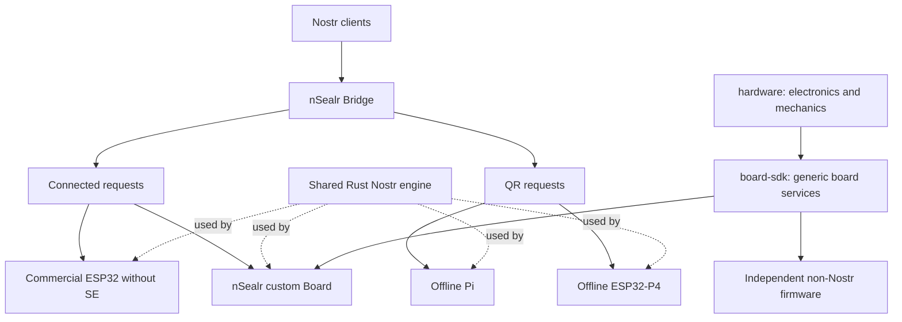

# nSealr restart and execution

This is the engineering direction adopted for the restart. It does not mark future implementation or hardware tasks complete. Product software is pre-production.

The October 18 execution adds independently reviewed product requirements, source disposition, secret ownership, reproducible software tooling and bounded KiCad qualification. Read [the current task graph](../../plan/work-items.json) for accepted candidates, integration records and open work. Earlier readiness views are dated snapshots, not current status.

The objective is a useful Nostr signer ecosystem with accessible connected hardware, two independent offline implementations and a general-purpose programmable security board. Success means real client interoperability, understandable approval, reliable recovery and reproducible third-party development.

1. [Architecture and security boundaries](architecture.md)
2. [Repository and naming decisions](repositories.md)
3. [Execution and acceptance](execution.md)
4. [Measured source baseline](baseline.md)
5. [Machine-readable implementation graph](../../plan/work-items.json)
6. [Decision validation and feasibility limits](validation.md)
7. [Client and optical qualification plan](../product/compatibility-plan.md)
8. [Specification-first development and initial work packages](development.md)
9. [Product contract, feature matrix and user journeys](../product/contract.md)
10. [PCB pipeline, tool capabilities and reference designs](pcb-development.md); [current programmable-Board realization requirements](pcb-development.md#product-choice-before-h04).

The graph records **47 implementation tasks**, their dependencies, scope, acceptance and required resources. A research result or administrative rename does not close an implementation gate. Ready tasks still require source reconciliation and an accepted brief before implementation. No device release is qualified.

## Start here on the next session

Verify the actual checkout and run `python3 scripts/validate_restart_plan.py`. Follow [the execution handoff](implementation/handoff.md), reconcile actual branches/PRs with the graph, and select eligible work without duplicating an active author. Preserve the existing reviewed evidence; do not rerun completed tasks merely because a new session starts. Source changes, failures or unresolved concerns determine which checks must run again.

A02 consolidation, its bounded provenance-anchor repair and closure passed normal protected integration and actual resulting-main CI. The [A02 handoff](implementation/A02/closure/handoff.md) preserves original source roles, complete evidence and the failed earlier main run. P02 supplies the [current compatibility plan](../product/compatibility-plan.md) and [opt-in procedures](../product/research-protocols.md); these are planning, not observed interoperability or participant results.

The portable core includes S03's strict event parser, canonicalization, complete inspection and consuming one-use authorization. Its [delivery evidence](implementation/S03/delivery/README.md) separates independently tested source from integration status and physical guarantees. T01's [delivery](implementation/T01/delivery/README.md) binds the version2 capability/routing cutover to distinct source and criteria reviews, preserved failures and actual command evidence. [Root accepted actual T01 main7f](implementation/reviews/T01-final-delivery/adoption/actual-main-acceptance.json) after protected PR37, full resulting-main CI and fresh main-only source checks.

K01's six portable criteria are [accepted on actual main5d](implementation/reviews/K01-current-delivery/adoption/actual-main-acceptance.json): normal protected PR40, full PR CI39478676631, actual-main CI39480230426 and fresh main-only source checks passed. The [original portable engine proposal](implementation/K01/delivery/README.md), source-specific reviews and failed runs remain immutable historical proof. Existing transport signing and all device, real-key and production-provider qualification remain separate gates.

QP01's [reviewed preparation and host boundary experiment](implementation/QP01/README.md) are [adopted on actual main d41](implementation/reviews/QP01-current-delivery/adoption/actual-main-acceptance.json) after protected PR41, full PR CI and actual-main CI. All three QP01 and six Q02 criteria remain incomplete; QP01 stays planned. The public-fixture Python/Rust canary is not an ARM/image/physical result or product-adapter admission.

That accepted foundation includes QH01's [bounded QR ingress correction](implementation/QH01/qr-ingress/brief.md): derived length checks now precede static conversion and animated frame parsing, cumulative retained work and joined conversion. Existing provisional codec limits and framing remain unchanged. All five QH01 criteria remain incomplete; this is not a complete client/optical workflow or a framing freeze. The [distinct component review](implementation/reviews/QH01-qr-ingress/report.md) passes only this correction. The next [injected manual QR service component](implementation/QH01/delivery/README.md) is a separate branch delivery proposal with [distinct runtime and corrected-test reviews](implementation/QH01/delivery/README.md); it enables no default route/readiness and does not complete QH01. Its exact final metadata review and protected PR/main gates remain required. Actual release state always comes from [the sole task graph](../../plan/work-items.json) and required GitHub checks. The historical f2 evidence index remains at1,508 files; new results use scoped graph-bound proof. Source notices, archival, registry publication and physical qualification remain separate work.

## Delivery order

Q01's [documentary closure proposal](implementation/Q01/delivery/closure/handoff.md) binds the original independently reviewed Pi/P4 custody, optical and verification requirements to the exact accepted delivery source and actual T01 main. Its integrated graph state is a branch adoption proposal pending exact final metadata review, protected PR and actual resulting-main gates. The procedures remain future device/client/release work; no runtime or physical qualification follows.

The first software milestone is a real request → device review → one-use authorization → valid response on an accessible board, with the expected key identity verified end to end. Offline Pi/P4 feasibility and board electronics research run alongside it. No date is promised before measured throughput and physical lead times exist.

The first public release is whichever retained profile satisfies its own safety and usability gates. General Board/SDK delivery has its own non-Nostr acceptance and does not wait for a complete wallet, SSH or FIDO application.

Old documentation, firmware profiles and fixtures remain source material during migration. Names and behavior inherited from them are not a compatibility commitment. Remove replaced active code when the replacement is verified; history remains in Git.

The diagram is the target architecture. It does not claim the depicted applications or PCB are already implemented. The SDK supports one trusted firmware image initially; future SSH/FIDO/wallet firmware needs separate application qualification.
