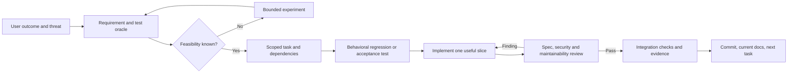

# Development from requirements to evidence

This is the operating contract for the restart, read with [execution](execution.md). The 47 parent tasks in `plan/work-items.json` are the roadmap, not 47 implementation-ready specifications. Their state remains authoritative there. The initial work packages below make the next steps concrete; later packages must be detailed against the source and measured interfaces that exist when their dependencies finish.

## What must exist before implementation

For each bounded change, record one brief containing:

1. **Purpose and authority:** parent task, stable requirement IDs, intended user outcome, source/protocol revisions, input commits and applicable threat model. Distinguish accepted requirements from hypotheses awaiting an experiment.
2. **Observable contract:** supported inputs and outputs, state transitions, failures, maximum sizes/time/state, custody and approval effects. For hardware, include electrical tolerances, operating conditions and lifecycle assumptions.
3. **Owned boundary:** current files/modules and consumers; interface definitions where another task depends on them; writable scope and one implementer. Use current source paths in the implementation brief, without making historical paths part of the product specification.
4. **Evidence plan:** exact command or physical procedure, independent expected result, negative cases, required resources and conditions that make the experiment inconclusive. An expected value computed through the implementation under test is not an independent oracle.
5. **Decision and delivery:** alternatives rejected with reasons, dependencies, unresolved questions, independent reviewer and integration gates. A missing security decision blocks the affected implementation; a separate experiment may resolve it.

Do not write a second universal planner or copy task state into multiple trackers. Keep the brief, implementation and evidence in Git. A GitHub issue can point to the authoritative task/brief. If subtasks need independent assignment, dependencies or completion states, promote them into `plan/work-items.json` and update its graph checks atomically; otherwise they are ordered steps inside their parent, without a second status ledger.

An accepted specification is reviewed before code is implemented against it. The existing authorization permits routine reversible design decisions; repeated maintainer approval is unnecessary. Ask for missing product intent only where source inspection, an experiment or the stated objective cannot resolve it. A review by another AI agent is useful engineering review, not an external security certification.

## Small delivery loop

For a security behavior or defect, first make the undesirable behavior observable with a failing test or saved reproduction; establish that it fails for the intended reason. Implement the smallest coherent change, repeat the relevant check, then refactor with those checks passing. Feasibility code is disposable unless separately qualified. Documentation-only changes need source/link consistency review, not tests that merely assert the new prose exists.

The reviewer assesses three separate questions: does the result implement the accepted specification; is that specification adequate for the threat and actual use; is the implementation maintainable and correctly integrated? A green style check cannot answer the first two. For high-risk changes, add an independent adversarial experiment rather than more reviewers reciting the author's tests. Preserve failed observations, their resolution and the exact final candidate. A changed diff invalidates affected review.

Test at the boundary where the claim exists: portable engine tests for canonical operations; adapter tests for host/device boundary behavior; real-device tests for review/input/entropy/custody; browser/client tests for interoperability. A simulator cannot stand in for an assembled device. Numerical parser/QR limits and latency budgets are versioned per target and tested at the boundary, just below it and above it. Do not silently relax them to make a test pass.

## Current delivery scope and cleanup

The 2026-10-25 milestone in the sole graph controls current work. Use one short
contract and useful delivery containing source, proof, limits and current docs;
include author, distinct reviewer, exact inputs/candidate, behavior and negatives.
An existing brief can be amended for affected scope rather than spawning a
separate branch/report/task for each admission or copy. Review the final candidate
once and only the affected correction thereafter, retaining unchanged evidence.

Use real-dependency smoke checks early, focused checks while developing and the
mandatory complete gates on a stable candidate. Reuse original receipts instead
of repeating unchanged campaigns for handoff, renaming or metadata packaging.
Never remove negatives, lower limits or bypass required checks. The root is the
single CI observer; unchanged runs are checked no more often than every180s.
After normal integration, verify actual rewritten identities/tree and resulting
main CI. Documentation-only reconciliation uses structural/source checks and
mandatory repository checks, without an additional manual full-CI campaign.

Finish each delivery by removing completed operational worktrees, obsolete refs
and unused cache after unique necessary source/proof is recoverable in the single
private backup. Do not delete tools still in use or restore historical trees for
old paths. Cleanup is also part of milestone completion, not a second tracker.

## Historical first tranche: ordered steps with concrete outputs

These are the original foundation briefs, several since integrated. Their dated descriptions do not reactivate an author or override current graph status. Parent acceptance in the graph still applies in full. The suffixes identify steps, not additional stateful tasks. Parallel work requires disjoint paths; the coordinator checks shared interfaces before assigning it.

| Parent | Ordered steps | Deliverable and check |
| --- | --- | --- |
| R00: reproducible baseline | R00.1 pin repository/tool inputs; R00.2 make one clean bootstrap explicit; R00.3 run baseline and classify inherited failures; R00.4 replay in a fresh checkout | Environment and command manifest; clean-checkout logs; explicit live/hardware skips. Existing core CI is evidence to ingest, not proof that the remaining multi-repository bootstrap is finished. |
| P01: product requirements | P01.1 review the product contract and event/operation catalog; P01.2 define each profile's custody, actors and channels; P01.3 resolve backup, limits and approval UX with small prototypes; P01.4 map every accepted requirement to its owner and proof | Reviewed requirements and profile threat models. Unsupported event/DM operations have explicit rejection behavior. Unresolved choices have experiments and cannot be represented as supported features. |
| S01: host boundary | S01.1 reproduce identity substitution, ambiguous input and queue-bound defects; S01.2 specify account/session/origin ownership; S01.3 repair each boundary with an adversarial regression; S01.4 review browser/Node/device effects | Correct identity pinning, strict parsing and bounded retained state. Test reconnect, wrong signed author, changed account, duplicate/trailing fields and repeated short input, not only one oversized frame. |
| S02: secrets and crypto | S02.1 enumerate every secret owner/copy/log boundary; S02.2 define opaque key handles and qualified algorithms; S02.3 replace unsafe exposure and custom crypto where needed; S02.4 verify vectors and actual target limits | Secret-flow review plus independent vector and negative tests. The October 13 compile/link probes inform library selection; hardware timing, stack, entropy and side-channel claims remain device gates. |
| E01: CAD operations | E01.1 list necessary design operations; E01.2 pin a normally installable tool tuple; E01.3 execute nonempty schematic/PCB negative and positive canaries; E01.4 qualify save/reopen/export and archive failures | A per-operation capability matrix with source/version and raw results. A working adapter method or tool listing is insufficient. General routing, interactive schematic editing and independent product/manufacturing visual review remain explicit gaps; the canary author did inspect its GUI/PDF/SVG output. |
| A01: source disposition | A01.1 reconcile original source inventory with current hashes; A01.2 identify consumers and licenses; A01.3 classify each retained module; A01.4 plan imports/removals and required behavioral checks | Retain/repair/replace/retire inventory with source provenance. Passing old tests does not preserve a wrong contract. Replaced active implementations are removed after the replacement is verified. |
| O01: agent operation | O01.1 define bounded assignment/review records; O01.2 exercise evidence rejection; O01.3 complete one independent reviewed change; O01.4 resume it in a fresh session from Git only | Reproducible handoff and exact-candidate review. Existing validator tests cover structural rejection; they do not demonstrate full unattended operation or real reviewer independence. |

## Worked contract: one approval authorizes one exact action

This expands the existing S03 direction and illustrates the detail required before implementation. It is not a claim that the current `ApprovalGate` is correct. S03 starts after its dependencies, P01 and S02, finish. P01's accepted product requirements determine supported operations; S02 determines secret ownership. The implementation brief must pin the concrete types and files after that work.

| ID | Required behavior | Adversarial acceptance |
| --- | --- | --- |
| AUTH-01 | Approval is minted only from the device-owned review/input path after the entire supported operation can be inspected. | Host-supplied `approved`, a remote button event and a truncated/unsupported review cannot authorize signing. |
| AUTH-02 | A grant binds the canonical operation, selected account, current policy generation, request/session and device-owned expiry/lifetime rule. | Change one bound field at a time while keeping all others constant; each attempt rejects with zero crypto output. Host time cannot extend the grant. |
| AUTH-03 | The first execution attempt atomically consumes the grant before a side effect. Failure or lost response does not make it reusable. | Race two executions, retry after crypto/transport failure, or replay from another adapter: at most one execution attempt is authorized. New authorization needs a new review. |
| AUTH-04 | Cancel, lock, reset, expiry and relevant account/policy changes invalidate pending grants. A boot/session generation prevents resurrection. | Exercise each transition during receipt, review and execution. Simulate reset in the engine; repeat power cuts on the actual target before claiming device acceptance. |
| AUTH-05 | The signed output corresponds to the reviewed canonical event and selected public key; the receiver verifies both. | Reject modified output, unexpected signer, mismatched event hash and a response to another request. Preserve a valid control case. |

The grant may be an unforgeable in-process capability in one trusted image; do not add a token protocol without a real cross-boundary need. Expiry uses a monotonic device/session rule appropriate to the target, not an assumed trustworthy wall clock. Public-key disclosure, encryption and decryption have their own explicit consent rules; they cannot borrow a signing grant.

A transport may retransmit an already completed, request-bound response under a defined bounded retention policy. It must not re-execute signing to reconstruct a lost response without fresh authorization. Distinguish response retransmission from operation replay in the tests.

Suggested S03 steps are contract/state review → failing portable behavioral cases → implementation and race/replay checks → independent final diff review. Exact hardware reset/physical-input proof belongs to V01/V02/V03 or the relevant QR profile; S03 can prove only its portable boundary. This preserves release independence while keeping the stronger device claim gated.

## Dependency and language discipline

Rust is the default for the shared semantic engine and new embedded application code where the target stack is qualified. Memory safety removes classes of faults; it does not prove constant-time behavior, entropy quality, authorization, a safe `unsafe`/FFI boundary or PCB correctness. Pin and review dependencies, select features narrowly and remove unused ones. A maintained, qualified crypto implementation is preferable to private cryptographic code merely to reduce dependency count.

Keep TypeScript for actual browser/Node integration. A Python Pi camera/UI adapter or vendor C peripheral adapter can remain behind a narrow tested boundary if that is the simplest maintainable supported path. There is one normative Nostr engine, not independent Rust/Python implementations to keep synchronized. Adapters own real target differences; do not force a universal HAL or plugin system before consumers require it.

## Workflow references evaluated on 2026-10-18

These are research inputs, not installed or automatically invoked project skills. The user's “Pollock” reference has not been identified conclusively; Matt Pocock is evaluated as a relevant candidate, without attributing that intent to the user.

| Primary source | What informs this project | Adaptation |
| --- | --- | --- |
| [Matt Pocock skills, pinned source](https://github.com/mattpocock/skills/tree/49dd158d1076134a641b33efb035946536778336/skills/engineering) | Separate domain clarification, specifications, small useful delivery slices and behavioral testing; assess specification compliance separately from code standards. | Our existing graph remains the tracker. Hardware experiments also need identified samples, conditions and a physical operator. Do not mark a task ready merely because a spec was written. |
| [Superpowers, pinned source](https://github.com/obra/superpowers/tree/bb92a77741419a4ab5f06e711a283343f1ada0c3/skills) | Scoped workspaces, concrete task briefs, review of the result and evidence before completion claims. | Preserve durable evidence and existing authorization. Use parallel authors only on disjoint scopes. Do not mechanically copy timing estimates, mandatory ceremonies or tool-specific prompts. |
| [NIST SSDF 1.1, final](https://csrc.nist.gov/pubs/sp/800/218/final) | Security requirements, protected development/release inputs, design/code/test review and vulnerability response belong throughout development. | A checklist is not certification. Match checks to actual attack surfaces and preserve operational recovery/incident ownership. [SSDF 1.2 is still listed as a draft](https://csrc.nist.gov/pubs/sp/800/218/r1/ipd) in the source consulted. |

The resulting process is intentionally ordinary: clear contracts, small commits, tests at the right boundary, separate review and an honest handoff. Its effectiveness must be demonstrated through O01 and real delivery; no skill package guarantees correctness.
