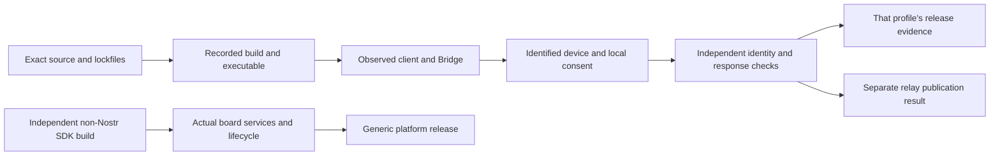

# Client and profile qualification plan

This plan selects reproducible test candidates and the evidence needed to admit a workflow. It announces no compatible device or browser. P02's accepted [brief](brief.md), [source register](source-register.json) and [opt-in protocols](research-protocols.md) define its boundary. The requirement input is [accepted P01 at f2ef70f](https://github.com/nSealr/nsealr/blob/f2ef70f522af4977e15f81554a8c6eadcdbe8097/docs/restart/implementation/P01/requirements.md). Current normative navigation must be reconciled with adopted A02 before integration; frozen P01 evidence remains unchanged.

## First candidates

| Candidate | Exact source/build inputs | Decision and limitation |
| --- | --- | --- |
| noStrudel 1.1.0 | `69c3c2397e86b116481d14f91cbbda3fa8b439b8`; checked-in pnpm lock; declared `pnpm@11.2.2` | Current source-build candidate, including newer relay/timeline changes than dated0476cad. Its `next` Applesauce dependencies resolve to `0.0.0-next-20261014162338`. The v1.1.0 tag points to a different commit. No source build or deployed-site correspondence has been tested. |
| Coracle 0.6.41 | `8f4d34cc16bfb4380208923d26307fab561a867d`, also tag0.6.41; checked-in lock; declared `pnpm@10.33.0` | Retain the dated source because it still matches current default/tag. Welshman0.13.0 supplies an independent stack. The GitHub latest-release API returned0.6.35; tag, package and release artifact are distinct. No source build or deployed-site correspondence has been tested. |
| Chromium-family browser | Chrome for Testing155.0.8059.84, Linux64, revision1697595 from the official version API | One explicit Chromium-engine product for the first run. Reconcile exact binary/build/hash before execution. Stock Chromium, Brave, Edge, other OSes and mobile browsers require separate evidence. |
| Firefox | Firefox158.0, Linux x86_64, official release metadata dated2026-10-13 | Separate engine/lifecycle test. Existing extension background configuration has [issue26](https://github.com/nSealr/nsealr/issues/26); package-unit success is insufficient. Exact binary/build/hash still needs qualification. |

The machine-readable register is authoritative for recorded digests, source paths, dependency resolutions and browser metadata. These selected browser versions are observations from official APIs on2026-10-18, not installed executables. If an upstream version advances, do not silently change a run. Reconcile a new candidate deliberately; preserve old results. The nSealr product's pinned pnpm10.33.4 is separate from each client's declared manager. Select and record a compatible exact Node runtime before client builds; the existing project runtime is an initial candidate, not proof of either client build.

Use two exact source builds before testing changing deployed websites. A website run must record its observed origin, assets/build identifier and correspondence limits. It cannot inherit the source-build result from its name. Add another client only to resolve a concrete coverage or feasibility gap; do not retain an unusable candidate through deprecated methods or blind signing.

### Prospective source-build procedure

These commands are planned C01 work and have not been run in P02. In separate exact source checkouts, record the selected compatible Node runtime and use each declared package-manager version. Run `pnpm install --frozen-lockfile`; build noStrudel with `pnpm run build` (its actual script is TypeScript checking followed by Vite), and Coracle with `pnpm run build:web` (the selected web script, rather than its native synchronization build). Preserve failed install/build output and the unchanged lockfiles. A failed build leaves that candidate unqualified; changing a dependency requires a new explicit source reconciliation.

Serve the resulting build on a controlled loopback origin with `pnpm exec vite preview --host 127.0.0.1 --port 4173`, then repeat the origin-isolation cases with a separately recorded origin/port. C01 records the actual loaded assets and uses the exact browser's official extension installation/debugging procedure to exercise the qualified extension/native-host package. A dev server or packaged-manifest mock does not replace the real background, injection, lifecycle and device tests. Actual commands, runtime versions and outcomes belong in that run record.

## What each delivery proves

| Delivery | Applicable scenarios | Actual acceptance owners |
| --- | --- | --- |
| Commercial ESP32, USB, no SE | P02-G01–P02-G08, P02-C01–P02-C04, P02-M01–P02-M08 | C01/C02 shared integration; D01/D02/V01/D03 actual board, custody and independent release |
| Custom Board Signer, connected | P02-G01–P02-G08, P02-C01–P02-C04, P02-M01–P02-M08 | C01/C02 plus S04/V02/V03/S05; final evidence on the actual custom PCB |
| Offline Pi, QR | P02-G01–P02-G08 and P02-Q01–P02-Q05; no initial DM or automatic grants | Q01/QH01/QP01/Q02/Q04 |
| Offline P4, QR | P02-G01–P02-G08 and P02-Q01–P02-Q05; no initial DM or automatic grants | Q01/QH01/QP02/Q03/Q05; independent of Pi |
| Generic Board + Board SDK | P02-B01–P02-B06; no Nostr client or Signer pilot prerequisite | B01/B02/B03 and relevant H-series evidence; independent of V03/S05/R01 |

Common Signer requirements are shared semantics, not identical boot/custody/physical guarantees. Publish each profile's exact radio, debug, boot, persistence, entropy, PIN, update and physical-attacker limits. A software-disabled radio is not physically absent. The SDK initially serves one trusted firmware image; generic hardware does not certify future FIDO, SSH, wallet or hostile-application isolation.

A run can stop at any boundary. Label the result source-supported, simulated, observed-client, observed-device or release-admitted, naming the boundary. These are evidence descriptions, not universal security grades. No generic release waits for a Nostr pilot, and no Pi/P4/ESP32 release waits for another profile's participant. Applicable shared safety prerequisites still apply.

## Required run record

Before execution, record the owner task and requirement/scenario IDs; exact client commit/package/lock/install/build inputs; accepted NIPs revision; nSealr source and single active contract artifact digest; SDK/Bridge/extension/native-host build and package hashes; browser version/build/executable hash; OS/architecture; exact device assembly/MCU/firmware/boot configuration; relay software/configuration; fixture account and independently expected full public key. Unknown fields make the affected result inconclusive, not a supported default. Record assistance and instrumentation that change the tested boundary.

Use controlled fixture identities and relays, not an existing personal account. Recovery material stays on the local device/recovery path. Public test-only backend results cannot enable product signing. For each case preserve ordered requests, device review/input, response correlation, exact event bytes, independent canonical ID/signature/public-key checks, publication outcome, timestamps/elapsed durations, observed state/queue bounds and errors. Logs must not acquire production secrets. A valid signature alone cannot prove a one-use authorization: retain provider-invocation/state evidence from the qualified implementation and repeat relevant device fault tests.

Scenario IDs are namespaced by P02; the owner column names canonical roadmap tasks. Each row below is a procedure to execute later. Inputs are the run record plus that row's fixture/action; the expected column defines the oracle. Record `pass`, `fail` or `inconclusive`, with evidence and an owned next action. A missing device, browser, source build or required observation is inconclusive. A violated requirement is fail. Source references and simulated checks cannot replace the actual evidence named in the row.

## Common Signer scenarios

| ID / input | Expected observable result | Hostile variants and evidence | Owner |
| --- | --- | --- | --- |
| P02-G01 initialize/import fixture identity | Actual custody yields the independently expected full public key; local setup/recovery UI is usable. | Entropy failure, invalid scalar/checksum and unexpected identity: no usable identity/secret output. Capture local flow and independent key check. | K01; relevant D02/V02/V03/Q02/Q03 |
| P02-G02 pair/get-public-key | Transport peer and user key remain distinct; confirm actual device key and bind client/account. Pairing is no signature consent. | Substitute either key, reconnect, revoke, switch account or replay connect; no stale binding. Observe both client and device. | S01/C01/QH01; profile integration |
| P02-G03 public catalog | Exercise key disclosure and kinds0/1/3/5/6/7/10002 under exact P01 semantics: every signed field/tag inspectable, accurate replacement/deletion/repost warnings. | Change each field after review; malformed known tags, unsupported kinds, hidden/truncated content or unverified target presented as verified must reject. Coracle's current Comment/1111 reply is explicitly outside the kind1 reply scope. | K01/C01/QH01; profile UI/release |
| P02-G04 authorization lifecycle | One complete local review can authorize at most one exact execution attempt, consumed before side effects. | Cancel, lock, reset, expiry, policy/account change, transport failure, lost response, retry and two contenders; zero stale execution. Cached retransmission, if supported, never invokes signing again. | S03/K01; D03/V03/Q02/Q03 |
| P02-G05 independent response | Receiver checks request/session, expected user, canonical ID and signature before accepting. Report publication separately. | Mutate correlation, author, event, ID and signature independently; duplicate/late output cannot become another action. Save positive and negative wire observations. | S01/C01/QH01; profile release |
| P02-G06 local recovery | Qualified local entry/display restores the expected identity without Bridge receiving the scalar. | Wrong checksum/key, interrupted flow and accidental ordinary-operation QR; compare full identity locally. A backup copy does not revoke another device. | D02/S04/V02/V03/Q01/Q02/Q03 |
| P02-G07 finite limits | Enforce accepted per-profile input/output, tags, cumulative bytes, work, queues and deadlines before expensive/unbounded work. | At/below/above each actual bound; many small requests, incomplete frames and slow peers. Measure memory/work/cleanup on the actual target; do not raise limits to pass. | T01/K01; D01/V03/QP01/QP02 |
| P02-G08 lifecycle and hardware claims | Enforce and describe that profile's actual boot/update/debug/interface/persistence and ownership rules. | Power loss, interrupted write/update, rollback, wrong owner and reset/re-enrollment. Record exact authorized sacrificial configuration; unsupported guarantees stay unadvertised. | D02/S04/H02/H02S/V02/V03/Q02/Q03; respective release |

## Connected client and browser scenarios

| ID / input | Expected observable result | Hostile variants and evidence | Owner |
| --- | --- | --- | --- |
| P02-C01 NIP-07 from each selected browser/client | Correct provider injection, explicit origin permission and device request/result. Host origin/name remains a host claim. | Two origins/frames, navigation, denied permission, popup closure and interleaved requests; no origin-to-device-consent promotion. Actual browser UI/native-host trace. | C01; D03/V03 |
| P02-C02 bunker and nostrconnect paths | Complete source-specific handshake, separate expected user key, supported operation and revocation. | Wrong authenticated peer/user, stale session, malformed reply, disconnect/reconnect and optional switch_relays refusal. Test source-observed tolerance, never infer it is working nSealr integration. | C01; D03/V03 |
| P02-C03 extension/native-host lifecycle | Packaged extension actually loads and runs background/injection/native messaging across restart/idle. | Firefox issue26 must be reproduced and repaired; test background termination, native-host exit, listener cleanup and pending request cancellation on both browser engines. | C01 |
| P02-C04 manual review and client deadline | Measure queue, transfer, review and reply against actual client/Bridge/device deadlines. Give up predictably without automatic signature retry. | Delay on both sides of the observed deadline; timeout/abort is not proof an underlying NIP-46 request was recalled. Device expires authority independently; distinguish explicit cancellation from an abandoned promise. Do not claim immediate remote cancellation without an implemented observable channel. | C01/QH01; S03/T01; profile release |

OBS-01–03/10–13 in the register identify current source paths. The selected Applesauce default is60s; Welshman's signerCall stops waiting at30s and does not recall the underlying request. These are source constants, not measured end-to-end budgets. If complete device/optical review cannot fit, qualify an explicit supported configuration/client integration or reject that workflow. No timeout extension may mint device consent.

## Connected message scenarios

| ID / input | Expected observable result | Hostile variants and evidence | Owner |
| --- | --- | --- | --- |
| P02-M01 NIP-44 primitives | Qualified v2 algorithm and finite payload bounds; explicit independent vector/negative tests and separate consent. | Invalid encoding/version/MAC/padding/peer, oversized/cumulative inputs, crypto/provider failure. No stable conversation-key export or forward-secrecy claim. | C02/K01; D03/V03 |
| P02-M02 one-to-one text send | Device owns sufficient plaintext/recipient context and binds it to each actual authorized seal; sender and recipient copies are independently verified. | Substitute rumor, recipient, ciphertext, account, timestamp/metadata or another pending operation; interleave encrypt/sign calls and replay results. Record exact current client call sequence and device state binding. | C02; D03/V03 |
| P02-M03 message receive/context | Clearly separate bare decryption from an admitted verified-message workflow. Verify each context that the device claims before showing it as trusted. | Invalid outer/inner signatures/IDs/authors, mismatched rumor/recipient and missing context. Peer+payload alone cannot prove a complete signed outer event was supplied. Observe actual disclosure/consent and independent checks. | C02; D03/V03 |
| P02-M04 fresh receiving setup | Locally review complete kind10050 replacement, exact relays, identity and explicit withdrawal for empty list; sign, then separately publish and receive through the advertised relays. | Malformed/duplicate known tags, unsafe URI, failed publication, wrong author and stale advertisement. No trusted before/after diff without verified prior state. | C02; D03/V03 |
| P02-M05 recipient mailbox discovery | Validate recipient advertisement/identity and delivery policy; absent/invalid list means unavailable, without arbitrary-relay fallback. | noStrudel's source fallback requires correction/qualification. Capture actual destination relays for absent, empty, invalid, stale and competing advertisements; state freshness limits. Coracle library support is no whole-client proof. | C02 |
| P02-M06 AUTH-required DM relay | Distinct locally reviewed22242 action for the exact URI/challenge, a declared freshness model and actual connection; never an ordinary post or borrowed DM consent. | Reconnect/change challenge, wrong relay, expired/cancelled/replayed challenge and host time/context claims. Verify signer/relay separately; do not attest origin or wall time merely by display. | C02; D03/V03 |
| P02-M07 unsupported operations | Explicit unsupported errors for NIP-04/kind4, group/file messages, opaque arbitrary signing and initial offline DM. Public operations still have their own qualified result. | Both candidates request NIP-04; test rejection without silent fallback. Reject kind15 and unadmitted extensions rather than losing review semantics. | C01/C02/T01/K01 |
| P02-M08 cleanup and bounded state | Error/timeout/account switch leaves no reusable authorization, leaked secret or unbounded plaintext/queue retention. | Encryption success then seal failure, disconnect, partial duplicate sequence and many received wraps/retries. Capture state cleanup and the exact receiver retry behavior. | C02/S03/T01; device integration |

OBS-04–09 establish the source trace and gaps. Current stock clients use separate primitive encryption and seal-signing calls. This plan neither invents a new standard method nor declares all staged stock integrations impossible. C02 must choose and test sufficient device-owned staged binding or an explicit compound integration, documenting any required client changes. Client-side verification alone cannot become device-owned verified context. An unadmitted DM path blocks that connected guarantee; it is not a silent public-only downgrade of the accepted connected release.

## Offline QR scenarios

| ID / input | Expected observable result | Hostile variants and evidence | Owner |
| --- | --- | --- | --- |
| P02-Q01 full client→Bridge→QR→device→QR→client | Original request remains correctly correlated and finite; local review/consent produces a public response independently verified before client acceptance. | nostrconnect pairing QR is not an operation. Wrong signer/session/account/type/version and completed/expired request reject. Measure all hops and actual client timeout. | Q01/QH01; Q02/Q03 |
| P02-Q02 real optical transfer | Actual selected display/camera can inspect, scan and recover a bounded transaction at recorded conditions. | Distance/angle/light, glare, damaged/dropped/reordered/duplicate/mixed frames, parser extremes and busy decoder. Measure usable rates, work/memory and timeout; a codec round trip is not optical proof. | QP01/QP02; QH01/Q02/Q03 |
| P02-Q03 volatile identity/power loss | Power loss clears owned authority/session material under documented limits; local reload restores expected identity. | Interrupt receive/review/response; inspect swap/core dumps/storage where applicable and actual active interfaces/radio topology. No persistence, erasure or radio-absence claim from a successful flag. | Q01/QP01/QP02/Q02/Q03 |
| P02-Q04 recovery and ordinary output separation | Local conspicuous recovery flow is distinct; normal response QR contains only admitted public results. | Scan nsec/recovery payload on the operation path; seed material never appears in normal output. Check complete recovery ergonomics on each actual device. | Q01/Q02/Q03 |
| P02-Q05 unsupported/late/repeated work | Initial profiles reject DM and persistent/automatic grants. Cancellation/expiry/mixed sessions cannot resurrect approval. | Repeat response, scan old/new requests alternately, change policy/account, lose browser request, and power-cycle. Pi and P4 each close their own findings. | QH01/Q02/Q03/Q04/Q05 |

## Generic Board-developer scenarios

| ID / input | Expected observable result | Hostile variants and evidence | Owner |
| --- | --- | --- | --- |
| P02-B01 independent clean developer | Build a concrete non-Nostr example from the published Board SDK/bootloader/hardware compatibility tuple, without nsealr or sibling checkout. | Clean machine/cache and different checkout; missing/wrong versions fail explicitly. Record help/AI assistance and first successful physical run, not compile alone. | B01/B02/B03 |
| P02-B02 actual generic services | Demonstrate claimed input/display/buses/power/key handles/storage/algorithms and entropy invocation/failure on exact hardware. | Missing SE, failed/stuck entropy, wrong key handle, reset and bus fault return meaningful errors. No simulated-success substitute or Nostr application dependency. | B02/B03; H-series |
| P02-B03 owner transitions | Reproduce allowed developer/owner-secured transitions, secret reset/re-enrollment, firmware-signing/update/recovery and explicit irreversible limits. | Wrong owner, partial MCU/SE erase, interrupted update, rollback and lost firmware root. Perform only on identified authorized sacrificial assemblies; no fuse ceremony is executed by this plan. | B01/S04/H02/H02S/B02/B03 |
| P02-B04 platform production evidence | Publish exact schematic/BOM/SDK/bootloader and production-test/lifecycle/shipping compatibility. | Independently qualify generic small-lot yield/provisioning and actual entropy provider on its own release binary/assemblies. Do not borrow downstream Nostr R01/V03 results. | H09/B03 |
| P02-B05 developer usefulness | Observe an independent developer following the docs to a physical non-Nostr result and explaining ownership/service limitations. | Record misunderstandings, abandoned steps and interventions; assisted success is not unaided success. No Nostr client participant is required. | B03 |
| P02-B06 application scope | Platform documentation accurately names qualified services and one trusted image. | A future SSH/FIDO/wallet firmware is separately implemented/qualified; no application certification, multi-app isolation or chip-native BIP340 claim follows from the board alone. | B01/B03; future application owner |

## Decisions and execution handoff

Stop a run on unexplained signing/identity change, a violated authorization or secret boundary, or unsafe physical behavior. Preserve the exact failing source/environment and hand the issue to its owner. Inaccessible source, absent hardware/operator or missing observation makes that claim inconclusive; no guessed success or default capability. Routine fixture/backend success cannot close a physical release gate.

C01/C02 own client and connected execution, QH01 plus each Q profile own optical execution, and B03 owns the independent developer/production demonstration. Each release applies its existing canonical acceptance and release template. P02 introduces no weaker release rule or new state ledger. The provisional8/10 setup and7/10 four-week use figures in dated research remain learning hypotheses, not statistical proof or newly imposed universal release prerequisites. Measure setup/recovery/approval latency and support burden before fixing performance targets. The separate human procedures below can run per profile when its required resources and applicable safety gates exist.
