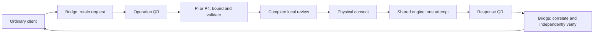

# Q01: common offline requirements, independent device qualification

Preparation only, authored from actual main1620ab19 on 20 October 2026. Its
runtime source is unchanged from qualified S03 maindbad6569. T01 is being
implemented from its reviewed cb39/ec97 specification; this document does not
claim that future interface is implemented. Reconcile the actual adopted T01
tuple once before admitting downstream implementation. No task or device is
accepted by this preparation.

Read the unchanged [product requirements](../../../product/requirements.md),
[event review](../../../product/event-review-contract.md),
[Pi/P4 threat models](../../../product/threat-models.md) and the exact sources
in [acceptance-plan.json](acceptance-plan.json). This specifies the three existing
Q01 criteria; it creates no additional product, transport or coordination system.

## First complete workflow

Each device owns its identity and consent. Bridge owns client/transport state;
it never receives the identity secret. Publication is a separate client outcome.
A nostrconnect pairing QR is not an offline operation or approval. Pi is the
proposed first physical prototype because the maintainer reports a complete
kit; the exact model, camera, panel, wiring, operator and access remain unknown.
P4 progresses and releases independently, without a Pi or custom-PCB gate.

## Custody and local recovery

Initial Pi/P4 profiles are manual and session-only, with one identity per
unlocked session. Native recovery uses the original identity in NIP-19 nsec form,
as required by PROD-03. A local text-entry fallback must be usable; a qualified
camera may import/export that same representation in a separate conspicuous
recovery flow. Check the checksum/scalar and show the actual derived public key.
Original-nsec recovery must survive backend scalar normalization; K01 owns that
portable key representation. Unsupported recovery fails closed.

SeedSigner describes useful hardware, not an inherited seed format or firmware
qualification. Existing SeedQR/CompactSeedQR/NIP-06 adapters are historical source
inputs; this proposal introduces no compatibility obligation or automatic import
for them. Any later additional format needs its own explicit recovery decision.
Operation intake never switches into recovery because an image contains a key,
and recovery never interprets an event or pairing URI as a key. Export requires
separate local intent; a signed-operation response cannot carry recovery data.

The shared Rust engine owns production signing semantics and operation-scoped
secret state. Q02/Q03 choose and measure the smallest actual driver/FFI boundary.
Retained Python/native decoders, camera buffers, interpreter objects and display
code remain in the trust boundary. Account for their copies and cleanup; Rust
ownership alone cannot prove their erasure. Do not pass a secret through Bridge,
CLI arguments, environment variables, logs, screenshots or persistent helpers.

## State, presentation and one-use authority

| State | Permitted transition and required invalidation |
| --- | --- |
| Locked / boot / update | No identity or signing authority. Establish the actual image/profile and allowed channels before local import. Update/debug/provisioning has its own declared locked mode. |
| Local recovery | Bound input and isolate import/export UI. Cancel/fault clears owned partial state; import establishes the actual identity without granting an operation. |
| Ready | One selected identity. Accept only the admitted public-key/discovery/public-event methods and that profile's finite limits. No first-release offline DM or automation. |
| Receiving | One bounded pending assembly. Reject mixed, excess, malformed or expired frames before parser/crypto work. A new request cannot silently replace a review. |
| Reviewing | Bind complete inspectable fields, identity, request, presentation epoch and local input sequence. Host labels/time/origin remain claims. Incomplete or failed presentation cannot authorize. |
| Attempt / response | The first execution attempt consumes authorization before clock/entropy/backend work. Verify completion under the actual selected key. A failed or stale attempt yields no eligible result. |
| Cancel / lock / identity change / fault | Invalidate pending assembly, review, authority, handles and eligible results before reuse. Re-import starts a new session. Reset or power return cannot resurrect approval. |

Use the admitted common public-event catalog and exact field/tag rules. Initial
kind-1 engine behavior is not proof that the complete release catalog works.
C02's NIP-44/17/59, kind10050 and relay-authentication workflows remain separate;
initial offline devices reject unsupported operations without downgrade.

Repeated scans do not create a new authorization. If the common protocol admits
cached-result retransmission, cache only the bounded already-verified response
under exact request/session/identity binding; it never invokes signing again.
Client and device deadlines remain separate finite constraints. Host time and a
request's created_at do not establish a trusted wall clock or authenticate origin.

## Optical and decoder limits

Use T01's versioned device contract; do not fork schemas for Pi/P4. QH01 compares
bounded single-frame QR with a maintained multipart UR implementation on actual
screens/cameras before freezing framing. Existing static/animated adapters are
candidates, not a decision to retain their protocol or hard-coded capacities.
Checksum/sequence/digest checks detect corruption and mixing; they do not
authenticate a sender or grant consent.

Every actual profile must configure and enforce finite raw image dimensions,
format/stride/buffer count, native decoder work/time and retained bytes, frame
bytes/count/lifetime, aggregate reassembly, request/content/tag bounds, pending
count, parse/crypto/cleanup time and response limits. Apply bounds before unsafe
expansion, allocation, unbounded decoding or expensive work, not only to the
completed JSON. QP01/QP02 and Q02/Q03 measure device feasibility; QH01 measures
the Bridge scanner/client path. Unknown limits block the affected operation;
legacy constants and a completed-payload check are insufficient. No new numeric
maximum is invented here. Reject padding/type/version/checksum faults in isolated
negative cases so one earlier error cannot hide the intended rejection.

## Image, channels and physical evidence

For each profile, the existing implementation/release evidence must identify
the exact board/silicon, camera, panel/controls/pins, boot media/image and binary
hashes, toolchain/providers, radios and companion chips, USB/data/debug/power
paths, update/recovery behavior, operator and applicable measurements. Reuse the
existing evidence structure; a wire descriptor or support manifest does not
authenticate attached hardware.

The normal operation channel is optical input/output plus local controls.
Enumerate every other actual path. Power-only intent, disabled networking or
an advertised family name does not prove radio absence or data isolation.
Any separate update/debug channel requires a declared state transition with no
live identity or pending authority and qualified return-to-operation behavior.

Pi needs actual Linux/boot-media/driver integrity and substitution analysis;
signed downloads do not establish enforced secure boot. Inspect swap, dumps,
journals, image/backup tooling, filesystem writes, camera images and interpreter
copies for secret persistence on normal and fault paths. P4 needs exact MCU,
SDK, DMA/memory and companion-radio evidence. Neither profile inherits an SE
non-exportability claim. State the physical-access limits honestly; Drop or
power loss is not proof of instant physical RAM erasure.

Trace the actual entropy source through linked/runtime code and device invocation
under [S02's contract](../S02/entropy-contract.md). A qualified OS CSPRNG/DRBG is
allowed. Initialization, health/failure/stuck-source behavior and complete-error
cleanup must be tested; output statistics alone do not qualify the source. No
deterministic or unqualified fallback produces a real identity/nonce/result.

## Delivery and independent next steps

The acceptance plan maps all three unchanged criteria to concrete review cases
and existing task owners. Requirements can be reviewed now; closure follows the
actual adopted T01 tuple and a distinct exact specification review. It does not
wait for both devices, select hardware, freeze QR framing or accept implementation.
QP01/QP02 prove each kit, Q02/Q03 implement and measure their own device, QH01
owns Bridge optical/client behavior, and Q04/Q05 independently qualify releases.
Use public test identities for instrumented prototypes. Preserve failed probes
and limits; no production secret or physical claim is required to review this
specification. Actual per-profile and release gates remain mandatory.
