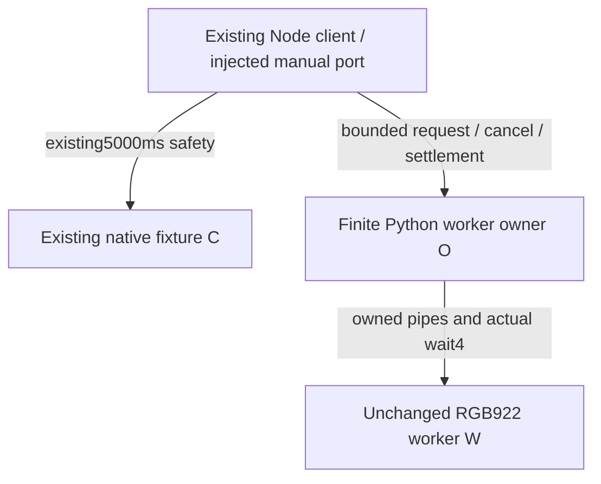

# Host image/request ownership — operational pre-code revision

**Proposal for independent admission; no implementation or experiment is admitted
by this file.** Base is actual main `bd892b70b88aeaf72b10ad5e9152bc36674513b9`,
tree `05e9848ebe9633fdb62c018fb565a579b1ee64d6`. The
[7996 brief](https://github.com/nSealr/nsealr/blob/7996b15d34766e0de1b8c395fb7bcc0b02079935/docs/restart/implementation/QP01/host-coordinator/brief.md)
remains an unmerged historical proposal based on5c. Its full branch is not
imported. This revision resolves only ownership at the current client/child seam;
its wider UI/renderer/coordinator scope and HC01–12 remain unimplemented inputs,
not granted product APIs or completed criteria. Exact source roles/hashes are in
[source-decision.json](source-decision.json).

## What the actual path currently owns

The Node engineering exchange directly spawns Python **C**, starts its unchanged
absolute5000ms SIGKILL timer at that spawn, and accepts exact R+EOF only after
the real EngineAdapter library/symbol initialization. Only controlled present()
sends the native request frame, at most947 bytes; C reads948 to detect oversize.
C has no RGB worker. The wrapper waits for C's actual close and its streams,
then returns the response. Port close currently awaits that same C-only pending
promise; prepareFresh checks C only. These facts are valid for native-only8b/bd892,
not a nested-worker ownership guarantee.

The actual client keeps its real100ms Promise.race, aborts/revokes on completion
or timeout, and retains its pending reservation until the underlying dispatcher
settles. Bridge keeps the manual port busy until close confirms reuse; a failed
close preserves quarantine. Neither layer acquires a grandchild's wait status.
The current fixture C supplies `cancel=lambda: False`; a client timeout cannot
be described as cancellation of an already-started native call. Late output must
be discarded; a provider operation already begun cannot be recalled.

The a16 ownership experiment observed C collected while W remained stopped/live;
O separately killed/reaped W. Its C was a supervisor fixture, not the current
native exchange; the invalid inference matters if W is nested in that exchange.
Its source is34e77697, early smoke af15, package
`a16fa6aae19a98066a206328d20578ce328f34d2`. Distinct review
`672335344e25b48eca37b9b5f37ca35d80062d8e` and root component acceptance
`a325acb770aebdd20dfc1b7e119474ee2ba2d189` are now frozen. They accept only the
bounded experiment; the separate selective assembly remains under review, not
integrated. The experimental subreaper is not an adopted product owner, and no
current native-path leak is reported.

## Two bounded choices

| Choice | Ownership and consequence |
| --- | --- |
| **A — proposed:** Node keeps C and a finite Python supervisor **O** as separate direct children; O alone spawns **W** | C stays under the exact existing5000ms timer. O owns W's stdin/stdout/stderr and actual wait4 from spawn through settlement, and survives C termination. No orphan transfer or late FD handoff is needed. One additional per-exchange process, no daemon/service. |
| B — retain C→W and add a subreaper guardian | A16 supplies a useful baseline, but the guardian must also own or receive all W IO handles and cover C death before PID/FD handoff. Merely acquiring an adopted PID is insufficient for the new data path. This adds adoption/handoff states while still needing an owner outside the5000ms kill target; not selected. |

Choose A for the first host path. The Node adapter composes existing lifecycle
promises; it is not a new pending/session engine. C never spawns W. O has one
active operational worker-supervision loop derived from reviewed922/06d mechanisms,
with explicit bytes/binary identity and cancellation. Historical corpus harnesses
stay unchanged and supply neither expected-response files nor an application API.
No new Rust code, dependency, driver or general process framework is proposed.

O's lifetime is not C's lifetime. No5000ms timer or overflow handler may blindly
kill O while W is unsettled. C close, C SIGKILL, readiness failure, client abort
or adapter disposal must invalidate O through its explicit control input; O stops
input, kills only its owned verified W when necessary, acquires actual status
and settles/closes all IO. O retains ownership/quarantine if that cannot be proved.
Node must retain O and its listeners rather than unref/detach it. Unexpected O
death without W settlement is an unknown outcome and quarantines the port; O's
close alone is not W evidence. O-crash survival/hostile descendants are not proven
by this choice and must not be silently promoted into a guarantee.

The aggregate operation/port.close must await C **and** O/W/IO settlement even
when C fails first. A Promise.race that rejects on C close and releases the port
while O is pending is forbidden. Only confirmed complete cleanup may permit a
fresh operation; stale eligibility remains revoked. Unknown W status, lost IO or
unconfirmed O termination cannot become a default zero status or a successful
close. Keep a live cleanup owner when possible; otherwise fail closed/quarantine,
no automatic retry or invented recovery. Retain the same port owner/factory;
recreating it must not reset quarantine for an unresolved operation.

## Request path and immutable budgets

Before actual client invocation, prepare C with its existing native readiness
contract and initialize O's fixed source/executable identity/control channel.
There is no request/image processing, W spawn, engine call, review or signing
during this preparation. Record these startup costs separately; do not call them
measured client latency. Readiness failure/unused disposal must collect every
process actually started, preserving its real exit status rather than assuming0.

On controlled present(), recheck before_present immediately before exposing the
fixed RGB bytes to O. W bootstrap, session/policy/G, image transfer and decode all
belong to the request phase. O accepts exactly172800 RGB888 bytes and returns the
original decoded frame≤512 only after exit0, bounded streams/EOF, acquired status
and final monotonic eligibility. The driver compares these exact bytes with the
actual presented request; mismatch refuses before C input. Then pass the original
frame to C without JSON/base64 reconstruction. W is already collected before any
native request begins. C's real response remains≤947, and the unchanged real client
independently checks key/request/template/ID/signature. The return scan is explicitly
software-injected; no decoded611 response image or complete optical loop is claimed.

The original request-kind-1-basic RGB image remains172800 bytes; its known
259-byte envelope is byte-identical to the current basic client request encoding.
This was checked by reading the frozen data, not a new decode/signing run. Use
the nonce-amended independent expectations for native output, never the historical
legacy signature as the zero-aux signing oracle. No warmup or replay response.

Keep client100ms and C5000ms unchanged: do not reset C's timer at readiness,
presentation or W completion. A100ms timeout can return before cleanup; existing
pending/busy ownership must remain held until real settlement. O's worker8s
eligibility is an upper bound, not permission to extend the client request;
cancellation can invalidate it earlier. Use one shared4s cleanup-observation window
from invalidation, never separate renewed observation/teardown windows. Expiry is
not cessation and does not authorize killing the last owner or releasing resources.

All13 worker parameters remain width240, height240, pixels57600, raw172800,
RGB888/3/stride720, AS268435456, CPU soft1/hard2 seconds, eligibility8s,
cleanup4s, stdout512, stderr512, chunk4096; CORE0 also remains. Preserve plain
posix_spawn/trusted setsid, parent kernel SID/PGID==W and actual prlimit/readback
before G/image, positive owned targets, bounded nonblocking IO, actual wait4 and
fresh final admission. Keep JSON704/static947 and existing client capacity/currentness
checks separate. C's native948 read/947 response/262144 diagnostic bound is never
reused as the172800-byte worker channel. No claim of RSS, cumulative allocation,
hard real time, secret isolation or physical latency follows from these limits.

## First proof gate, before the rest of the coordinator

Freeze the finite control/settlement record, malformed/EOF behavior and exact
effect expectations before implementing O or changing the injected adapter. A
control message must be bounded and tied to this operation/owned W; losing it
must not free the port. The following gate uses the actual client, C/library and
selected W; source-only unit doubles cannot substitute for these observations.

| Case | Required discriminating evidence |
| --- | --- |
| Startup / unused / failure | C exact real-library R+EOF, O initialized, zero W/request/G/image/native request before presentation; unused/readiness failure actually closes both started children with no late spawn. |
| Request / response | Original basic RGB → real W259 → exact original C input → real fixture signature/response → actual client acceptance under unchanged100ms. Record worker PID/status/IO, C ELF/input/output, ordered phases and all closes. No cached expected response. |
| Timeout / no early reuse | Hold a real owned operation at a source-bound phase; actual100ms timeout revokes success. Same-context and shared-port attempts remain refused while W/IO or C is held. Release only after actual collection, then a fresh operation can proceed. Never freeze clocks or extend deadlines. |
| Cancel | Before W spawn: zero W/G/image/C request. During W session/input: stop input and acquire status/IO with zero later C request. After C starts: discard late output and await C; do not assert no already-started backend effect. |
| C death | Exercise early C exit and actual C SIGKILL while W is demonstrably owned/live (e.g. controlled pre-G stop). O must remain alive with W handles, acquire terminal status and settle IO; Node cannot resolve aggregate close from C's event. Cover the pre-W/setup interval too. Keep the existing5000ms target and record whether an observed kill was injected or timer-caused. |
| Close / uncertainty | Prove bounded raw/error paths, no partial publication, one cleanup window, actual FD/status settlement and refusal on unknown/stolen status. Test-only held phases may expose the boundary; ECHILD without a known status is never zero. No dependent run when cleanup ownership is unresolved. |

Reuse the existing5 readiness controls,14 actual-client cases and source-identical
Rust/Bridge proofs in their original roles. Do not broaden into the old22 worker
campaign, Pi suite, a new corpus or build research for this documentary decision.
The complete UI/renderer work, fresh provisioning/integration checks and their
affected tests follow only after this ownership gate is admitted and proven.

Missing now: independent admission of this choice and the executable
O/aggregate-close proof above. The exact RGB ELF is
available and hash-verified, but this is not distribution/target provisioning.
There is no new product code, build, test, experiment, signal or CI observation in
this revision; all task/status/resource/release sets and physical unknowns remain.
