# Pi human review: one timing/protocol decision proposal

2026-10-25, source-only author `/root/a02_final_review`; base actual main
`9c50c4c6ec4d28ee681bc678047f81abbbf06d7b`, tree
`5e983fe208858665df97071aa6765a4a625df15c`. **Selected direction, not feasibility
PASS or implementation admission.** First target is the already-public fixture
identity only. No import, compilation, test, actor, device, audit or CI ran.
The independent synthetic-UI work continues; this proposal neither edits nor blocks it.

## Decision and source constraints

Recommend a **versioned local interactive Rust session**, with bounded compute
commands and an explicit waiting-for-human state that retains the same owner.
No foreign callback or borrowed presentation survives that wait. This requires a
small additive core review API/policy contract and an opt-in fixture driver;
it is not implementable by relabelling the present C ABI as resumable.

Today's callback retains all borrows and human waiting inside host C5000. Neither
pausing that watchdog nor returning a cached action after `None` establishes an
existing suspend/resume contract. Choose explicit Rust-owned state; any alternative
provider would likewise need its own admitted protocol, not a timer override.

`AuthorizationSession` has no lifetime parameter: private `Pending` owns
`ParsedRequest` and its bounded event arena. `InspectionFrame` owns fixed strings;
`LocalPresentation<'a>` borrows only inside `present`, and `Execution<'a>` only while
signing. `ReviewDocument` is crate-private. No public prepare/commit-action pair
or context setter exists. `review_step` accepts synchronous fresh input with time
checked on both sides; `None` only preserves the cursor. No detached Python
approval or saved borrowed pointer supplies the missing transition.

The old core builds deadline `now+100`, binds it, configuration/key/session/operation,
review commitment and event ID, and consumes approval before clock/provider calls.
The fixture creates and destroys that owner within one native call; its callback
loop cannot suspend. Preserve this exact v1 path and its proofs.

## Owners, phases and clocks of the proposed new scope

```mermaid
stateDiagram-v2
    [*] --> Decode: existing Python owns O/W (8s / cleanup4s)
    Decode --> Prepare: known B3 settlement, original raw bytes
    Prepare --> Draw: Rust R owns request/key/context; bounded page compute
    Draw --> Human: exact complete draw commit, new page epoch
    Human --> Apply: fresh local gesture, same instance/operation/page
    Apply --> Prepare: Next; same absolute review policy
    Apply --> Sign: distinct final Approve; consume once in Rust
    Sign --> Publish: private staging + fresh context/caller checks
    Publish --> Settled: one response, known ownership
    Human --> Cancelled: reject/cancel/expiry/EOF
    Apply --> Cancelled: stale/context/draw failure
    Sign --> Cancelled: cancel/expiry/failure; zero release
    Draw --> Cancelled: bounded IO failure
    Cancelled --> Settled: actual close/collection
    Prepare --> Hold: death/protocol fault; close unknown
    Hold --> Settled: same retained handles finally collected
```



R is a proposed Rust fixture owner, distinct from decoder W. The local controller
retains exact channel/process handles, without a service. Draw has a finite IO
failure policy. Human waiting has **no active compute callback**; R monitors real
absolute expiry even without input. Every unsettled phase can enter Hold. Watchdog
expiry attempts cancellation/kill, never guarantees collection by a wall deadline.

| Clock/policy | Actual source and decision |
| --- | --- |
| Decode O8/shared4 | Existing acquisition/cleanup, unchanged; not page-reading time. |
| Host fixture C5000/client100 | Keep existing Node/helper/gates unchanged. C5000 covers its synchronous native callbacks; client100 is the qualified fixture selection, not a universal client limit. Node is not thereby required on Pi. |
| Core100 / `MonotonicSeconds` | Current conformance lifetime is100 trusted ticks; the host adapter uses whole elapsed seconds. Neither is a measured human policy. Never freeze/scale that clock to hide waiting. |
| Caller / remote client | Actual service uses `min(method.deadline_ms, transport.deadline_ms)`, each clamped to30,000ms; monotonic and account/capability/generation checks run before write and after completion, with abort and unsettled reservation retention. Metadata cannot extend it. A remote application may expire sooner; no measured client promise exists here. |

A new admitted policy must bind real monotonic units, finite absolute expiry and
policy/version into Rust context and visible catalog. Duration needs measurements/
requirements; Next/redraw/retry/reconnect never extend it. Old `begin_request`,
v1 catalog/100 and host gates stay unchanged. Do not assume v2 has31 pages or
generate its expected catalog from its run.

Caller expiry revokes publication; it cannot discard unknown ownership. Cancel/EOF
or local expiry invalidates before/after gestures and release; discard late bytes,
never attach them to a fresh request. A standalone fixture has no active service
transaction and cannot qualify an expired NIP-07/NIP-46 call. Connected admission
needs actual client/profile deadlines and compatible policy; no 30s change here.

## Minimum future changes and invariants

1. In `crates/nsealr-core/src/authorization.rs` and `review/event.rs`, propose an
   additive v2 owned-frame/accept-local-input transition and trusted review-policy
   construction. These are **new APIs requiring admission**, not callable existing
   methods. Internal pending presentation binds instance/operation/page epoch,
   exact frame/catalog/key/context and draw state; the exported frame/epoch grants
   no signing authority. Apply checks real currentness and consumes a fresh local
   gesture once; coverage advances only after complete draw. Reuse consume-first
   `sign_approved` semantics and shared validation; no public context mutation or
   approved flag. Old synchronous API behavior/tests stay intact.
2. Add one opt-in host fixture Rust driver, proposed
   `crates/nsealr-pi-engine-fixture/src/bin/review_session_v2.rs`, using the same
   core parser/catalog/key owner/signing and bounded envelope codec. Retain original
   raw bytes/hash separately from parsed owned fields; never reconstruct the input.
   Strict bounded local records and versioned phases are proposed, not a wire
   implementation. Exact incarnation/channel and checked epochs reject cross-owner,
   stale/replayed, malformed or duplicate messages. Only the trusted local draw/input
   port supplies events; QR/remote requests cannot mint one-use consent.
3. A separately admitted Pi provider may retain that owner and reuse settled B3
   decode/local UI; no legacy Python signer or replacement controller. Do not alter
   `engine_adapter.py`, old C ABI, `native-leaf.ts`, its timers, SDK or default
   routes for this proposal. A device implementation must prove equivalent required
   ownership/currentness/output properties under its own scope. Node-on-Pi is not
   selected; ARMv6/image/loader/runtime and actual IO remain unqualified.

No pre-signing, stored `Execution<'a>` or foreign callback across Human. Epochs
route events; they are not approval handles. Partial render cannot commit. Changed
operation/key/config invalidates old state. Consume once even on failure, stage
privately and recheck before release. Unknown ownership retains the same handles/
reservation even when reporting fails; no Python/O restart, replacement load or
automatic replay. Old C-death evidence does not qualify a new provider.

## First finite experiment and later negative acceptance

First propose **compile-only owned-state canary HRT-C01** on a disposable exact9c
checkout, after distinct admission. Full proposed Rust source and input identities
are in `source-bindings.json`. It uses only current public APIs: parse original259,
select public11×32, call one review step returning `None`, copy the complete frame
into owned bytes and move the session/raw/snapshot out of the decode-buffer scope.
`Waiting: 'static` must compile without unsafe, transmute, leaked pointers or
self-reference. It neither accepts a gesture nor signs; it does not prove that
`None` permits asynchronous approval. No new dependency/lock/vendor change.

```sh
# FUTURE ONLY, in disposable9c; source placed as the named core example
cargo +1.95.0 check --locked --offline -p nsealr-core \
  --example qp01_owned_review_canary --target-dir "$CANARY/target"
```

Compile failure stops and records the exact API/type gap; compile success proves
only owned representation. A v2 transition/policy/source contract then needs its
own admission before process or delayed-human experiments. Required later finite
negatives are:

| Boundary | Required outcome, not an execution claim |
| --- | --- |
| Delay | Owned state/raw/catalog stable while idle, no signature/provider; real time advances. Test below/at/after the admitted policy expiry, no arbitrary human duration or clock freeze. |
| Gesture/cancel/expiry | Cancel/expire before draw, after commit, immediately before/after final gesture and after private staging: zero release; post-consumption failures remain spent. |
| Stale/replay/context | Wrong incarnation/channel/epoch, duplicate gesture, reused request ID, key/policy/geometry/account change cannot reuse approval; fresh operation requires full fresh review. |
| Render | Fit failure, missing/reordered/truncated fragment, partial draw/commit failure or held/ambiguous input cannot advance coverage or authorize. |
| Death/unknown close | Retain original C-death gates; separately kill/fault the new owner in each phase. No result/new reservation until exact settlement; unknown EOF/wait/report failure holds original handles. |
| Output/caller | Independent event/key/template/correlation/signature match; one attempt only, no partial or late frame after local expiry, caller abort or changed generation. Never attach it to a later client operation. |

Missing: compiled owned representation, safe v2 transitions, human policy, admitted
compute/IO work budgets/watchdogs and caller compatibility. No feasibility PASS.
All47 criteria/contracts/evidence and five release paths stay unchanged; no
production custody/key/default route or physical attestation. STOP for distinct
root/B01 review; no run authorized.
